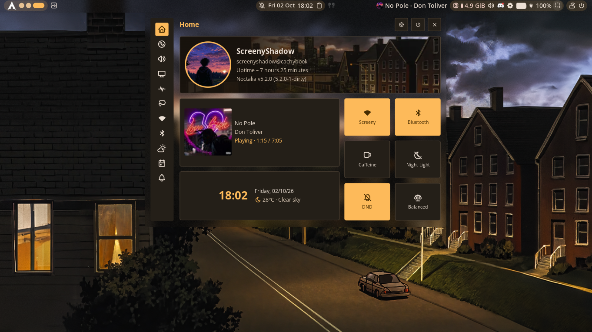

<div align="center">

# ✨ CachyOS · niri · Noctalia

**My blurry, translucent, wallpaper-themed Wayland setup**




</div>

---

> **Preview note:** the screenshots in this repository were captured on the
> original 1366×768 setup. The current configuration targets the internal
> 1920×1080 panel at 144.003 Hz. The screenshots are kept as a visual reference,
> not as proof of the current resolution.

## What I'm running

| Component | Choice |
|---|---|
| **Laptop** | ASUS TUF Gaming F15 FX506HC |
| **CPU / GPU** | Intel Core i5-11400H · NVIDIA RTX 3050 Mobile + Intel UHD |
| **RAM** | 16 GB |
| **Distro** | CachyOS (Arch-based) |
| **Compositor** | [niri](https://github.com/niri-wm/niri) 26.04 on Wayland |
| **Shell / bar** | [Noctalia](https://github.com/noctalia-dev/noctalia-shell) v5 |
| **Display** | `eDP-1`, 1920×1080, 144.003 Hz, scale 1.0 |
| **Terminal** | Kitty (Alacritty is installed but is not the configured terminal) |
| **Shell** | Fish + Starship |
| **Browser** | Firefox |
| **File manager** | Nautilus |
| **System info** | Fastfetch |

This repository is the source of truth for **my** configuration. It is derived
from the original `niri-noctalia-dots` project, but my display, phases, and
lock-screen settings intentionally differ.

---

## Quick start (fresh clone)

### 1. Install the required packages

```bash
sudo pacman -S --needed niri kitty fish starship fastfetch nautilus firefox python git
```

The scripts need Python 3.11 or newer because the state helper uses the
standard-library `tomllib` parser.

Noctalia is not in the Arch repositories. Install it by following the
[Noctalia installation guide](https://docs.noctalia.dev/noctalia/getting-started/installation/).
This repository targets **Noctalia v5+**; check the version with:

```bash
noctalia --version
```

### 2. Clone this repository

```bash
git clone https://github.com/supan1676/mydotfiles.git ~/mydotfiles
cd ~/mydotfiles

# Restore the executable bit if the repository was downloaded as a ZIP.
chmod +x apply-dots.sh toggle-phase.sh
```

The scripts also run with `bash apply-dots.sh ...` if you prefer not to change
the mode.

### 3. Review before deploying

```bash
./apply-dots.sh --help
./apply-dots.sh --dry-run
```

The dry run validates the staged Niri and Noctalia configuration without
changing `~/.config`, `~/.local/state`, or the running session.

### 4. Deploy

```bash
./apply-dots.sh
```

The script:

1. checks required files, commands, and the `eDP-1` display contract;
2. stages a complete copy of the configuration in a temporary directory;
3. validates the staged Niri and Noctalia configuration **before** touching the live files;
4. creates a unique backup under `~/.local/state/niri-dots/backups/`;
5. merges the repository files into `~/.config` without deleting unrelated files;
6. updates only the approved Noctalia lock-screen state;
7. re-validates, reloads Niri, and reloads Noctalia;
8. rolls back automatically if deployment, validation, or reload fails.

`apply-dots.sh` never runs `sudo`, never clones the upstream repository, and
never deploys `fish_variables`.

### 5. Check the result

```bash
niri msg outputs                  # confirm eDP-1, 1920x1080@144.003
niri msg windows                  # confirm the real app-ids of open windows
./toggle-phase.sh status          # confirm the active appearance phase
python3 verify_dots.py            # static checks; runtime checks run when tools exist
```

---

## Display configuration

The active output is defined once in
[`niri/.config/niri/config.kdl`](niri/.config/niri/config.kdl):

```kdl
output "eDP-1" {
    mode "1920x1080@144.003"
    scale 1.0
    transform "normal"
    position x=0 y=0
}
```

The refresh rate must match `niri msg outputs` exactly. The old upstream
`1366x768@60.002` mode is not used. `cfg/display.kdl` contains only comments
and a commented-out external-monitor template; it does not define a second
active output.

---

## Appearance phases

Only `~/.config/niri/cfg/rules.kdl` changes between phases. Display, input,
keybinds, autostart, wallpapers, and Noctalia state are untouched.

| Setting | Phase 1: `repo-default` | Phase 2: `personal` |
|---|---|---|
| Global window opacity | 0.90 | 0.75 |
| Window corner radius | 20 | 20 |
| Blur passes | 6 | 2 |
| Blur offset | 4.0 | 3.0 |
| Blur noise | 0.03 | 0.03 |
| Blur saturation | 1.2 | 1.0 |
| Firefox | 0.75, blur on | 0.75, blur on |
| Discord | 0.73, blur off | 0.73, blur off |
| Nautilus | 0.65, blur on | 0.65, blur on |
| mpv / VLC | 1.0 | 1.0 |
| Noctalia bar/panels/OSD | blur on, xray off | blur on, xray off |

Phase files:

- [`rules-repo-default.kdl`](niri/.config/niri/cfg/rules-repo-default.kdl)
- [`rules-personal.kdl`](niri/.config/niri/cfg/rules-personal.kdl)

### Switch phases

```bash
./toggle-phase.sh status
./toggle-phase.sh personal       # Phase 2
./toggle-phase.sh repo-default   # Phase 1
```

The active phase is stored in `~/.local/state/niri-dots/phase`. A normal
`./apply-dots.sh` run **preserves** that phase. On a fresh clone the default is
`personal`. To force a phase during deployment:

```bash
./apply-dots.sh --phase repo-default
```

`toggle-phase.sh` validates a staged copy of the full Niri config, replaces
`rules.kdl` atomically, validates again, and reloads with the real command:

```bash
niri msg action load-config-file
```

If validation or reload fails, the previous rules and phase marker are
restored. It does not use `git checkout`, because `~/.config/niri` is not a Git
repository.

---

## Lock screen

My target is a full-screen wallpaper with a darkened blurred background, a
large warm-cream clock, weekday/date below it, and a compact password row. The
lock screen intentionally has **no monthly Calendar widget**.

Current approved values:

- Lock screen enabled, lock before suspend enabled
- Blur intensity: **0.80** for the initial visual test
- Tint intensity: **0.45** for the initial visual test
- Wallpaper: `~/Pictures/Wallpapers/niri-noctalia-dots/city-girl-sunset.png`
- Palette: `wallpaper` / `m3-content`
- Clock: centered, upper-middle, format `{:%H\n%M\n%A\n%-d %b}`
- Login box: compact, centered, lower-middle, submit button enabled

Configuration is in
[`noctalia/.config/noctalia/config.toml`](noctalia/.config/noctalia/config.toml).
The `\n` in the clock format is intentional: Noctalia's date formatter turns
the literal two characters into a line break.

### Why the old Calendar can come back

Noctalia loads `~/.config/noctalia/*.toml` first and then merges
`~/.local/state/noctalia/settings.toml` on top. GUI edits and the lock-screen
widget editor write to that state file, so state wins over `config.toml`.

`apply-dots.sh` backs up the state file and runs
[`scripts/noctalia-state.py`](scripts/noctalia-state.py), which:

- removes **only Calendar widget tables** and their entries in `widget_order`;
- keeps the clock, login box, grid, schema version, and every unrelated setting;
- updates `[lockscreen].blur_intensity` and `tint_intensity` only when those keys already exist;
- updates a stale lock-screen wallpaper path or palette selection only when those keys already exist;
- writes atomically and never deletes the state directory.

Do **not** delete the whole state directory as a first fix. That loses unrelated
settings such as bar layout, plugins, and wallpaper choices. Inspect first:

```bash
grep -n -A 8 'lockscreen_widgets' ~/.local/state/noctalia/settings.toml
```

### Lock-screen editor

The editor only works while the session is **unlocked**:

```bash
noctalia msg lockscreen-widgets-edit
```

An `ok` response means the IPC request was accepted, not that the overlay is
visible or that the layout is correct. Verify visually, then close the editor
with `Escape` or:

```bash
noctalia msg lockscreen-widgets-exit
```

The editor writes layout overrides to `settings.toml`. If you edit the layout
there, the state file will continue to win over `config.toml`. Keep the layout
you want by either using the editor intentionally or removing only the
lock-screen widget state after making a backup.

### Testing the lock screen

> **Warning:** the following command locks the session immediately. Save your
> work, make sure you know your password, and do not run it over a remote
> connection without a recovery path.

```bash
noctalia msg session lock
```

There is no automatic "test without locking" mode. The approved test sequence
is: back up state, validate config, deploy, then lock manually. If the result is
wrong, unlock with your password and adjust the settings; do not delete the
state directory.

The lock-screen background follows the desktop wallpaper unless
`[lockscreen].wallpaper` is set. The deployment sets the wallpaper with
`noctalia msg wallpaper-set` and the palette with
`noctalia msg color-scheme-set wallpaper m3-content`.

---

## Backups and rollback

Every deployment and phase switch creates a unique directory:

```text
~/.local/state/niri-dots/backups/
├── apply-YYYYMMDD-HHMMSS.XXXXXX/
│   ├── config/{niri,noctalia,kitty,fish,fastfetch}/
│   ├── noctalia-state/settings.toml
│   └── rollback/
└── phase-YYYYMMDD-HHMMSS.XXXXXX/
    ├── rules.kdl
    └── phase-marker
```

The apply script rolls back automatically if staging, deployment, validation,
or the Niri/Noctalia reload fails. A phase switch restores the previous
`rules.kdl` and phase marker on failure.

To roll back manually, use the backup directory printed by the script:

```bash
BACKUP=~/.local/state/niri-dots/backups/apply-YYYYMMDD-HHMMSS.XXXXXX

# Restore only the files you want. These commands overwrite the live copies.
cp -a "$BACKUP/config/niri/." ~/.config/niri/
cp -a "$BACKUP/config/noctalia/." ~/.config/noctalia/
cp -a "$BACKUP/config/kitty/." ~/.config/kitty/
cp -a "$BACKUP/config/fastfetch/." ~/.config/fastfetch/
cp -a "$BACKUP/config/fish/config.fish" ~/.config/fish/config.fish

# Noctalia state is optional; restoring it also restores GUI overrides.
cp -a "$BACKUP/noctalia-state/settings.toml" ~/.local/state/noctalia/settings.toml

# Reload the restored configuration.
niri msg action load-config-file
noctalia msg config-reload
```

If Niri is not running, the restored files apply on next login.

---

## Troubleshooting

### "error: unrecognized subcommand 'reload-config'"

That command does not exist. Use:

```bash
niri msg action load-config-file
```

`apply-dots.sh` and `toggle-phase.sh` use the correct command and exit non-zero
if it fails.

### A rule is not applying

```bash
niri msg windows
```

Check the real `app-id` or `title`. The rules currently target `firefox`,
`discord`, `org.gnome.Nautilus`, `mpv`, and `vlc`. Some applications use a
different Wayland app-id; update the rule only after confirming it with
`niri msg windows`.

### Firefox still looks opaque

In `about:config`, set `widget.wayland.opaque-region.enabled` to `false`, then
restart Firefox completely.

### Noctalia config does not seem to apply

```bash
noctalia config validate
noctalia config export > /tmp/noctalia-merged.toml
```

Remember that `~/.local/state/noctalia/settings.toml` wins over
`~/.config/noctalia/config.toml`. Inspect it before deleting anything.

### Reload Noctalia without logging out

```bash
noctalia msg config-reload
```

### Kitty theme is missing

Check that the include path resolves relative to `kitty.conf`:

```bash
ls ~/.config/kitty/themes/noctalia.conf
kitty +kitten themes --help
```

### Verify the current state

```bash
niri validate
niri msg outputs
niri msg windows
noctalia config validate
python3 verify_dots.py
```

`verify_dots.py` reports `SKIP` when a runtime tool is unavailable. A skipped
check is not a pass.

---

## Verification suite

```bash
python3 verify_dots.py
```

The suite checks, among other things:

- all eight Niri includes exist and appear exactly once;
- `eDP-1` uses 1920×1080@144.003, scale 1.0, normal transform, position 0,0;
- there is exactly one active output block and one top-level blur block;
- the active `rules.kdl` matches the personal phase and both phase files contain their expected values;
- Firefox, Discord, Nautilus, mpv, and VLC rules have the intended opacity/blur;
- Noctalia TOML parses and the lock-screen widget order contains only clock + login box;
- clock/login positions, format tokens, colors, shadow, and compact layout are present;
- the Kitty include resolves and the theme uses valid hex colors;
- Fish guards optional files and initializes Starship;
- Fastfetch JSONC parses (comments and trailing commas supported);
- wallpapers contain valid PNG/JPEG/WebP data;
- both shell scripts pass `bash -n` when Bash is available;
- scripts use the real reload command, back up, stage, roll back, and do not use `sudo` or the upstream clone URL;
- README/CHANGES commands match the scripts.

Runtime checks (`niri validate`, `noctalia config validate`, `fish -n`) are
skipped if the corresponding tool is not installed. The suite does not replace
a visual test of the live lock screen.

---

## Repository structure

```text
mydotfiles/
├── README.md
├── CHANGES.md
├── apply-dots.sh                  # staged deploy + backup + rollback + reload
├── toggle-phase.sh                # safe Phase 1 / Phase 2 switch
├── verify_dots.py                 # static + optional runtime verification
├── scripts/
│   └── noctalia-state.py          # selective Noctalia settings.toml migration
├── niri/.config/niri/
│   ├── config.kdl                 # output + includes
│   └── cfg/
│       ├── animation.kdl
│       ├── autostart.kdl
│       ├── display.kdl            # comments + commented external template
│       ├── input.kdl
│       ├── keybinds.kdl
│       ├── layout.kdl
│       ├── misc.kdl
│       ├── rules.kdl              # active phase (personal)
│       ├── rules-personal.kdl     # Phase 2 source
│       └── rules-repo-default.kdl # Phase 1 source
├── noctalia/.config/noctalia/
│   └── config.toml                # lock screen, widgets, theme, wallpaper
├── kitty/.config/kitty/
│   ├── kitty.conf
│   └── themes/noctalia.conf
├── fish/.config/fish/
│   ├── config.fish
│   ├── conf.d/uv.env.fish
│   └── fish_variables             # reference only; never deployed
├── fastfetch/.config/fastfetch/
│   └── config.jsonc
├── wallpapers/
└── screenshots/                   # legacy previews
```

`niri-noctalia-dots-fixed.tar.gz` is an old archive of an earlier state. It is
not used by the installer and can be removed in a later cleanup after approval.

---

## Keybinds

| Keys | Action |
|---|---|
| `Mod + Return` | Open Kitty |
| `Mod + B` | Open Firefox |
| `Mod + E` | Open Nautilus |
| `Mod + Q` | Close window |
| `Mod + O` | Overview |
| `Mod + Ctrl + Q` | Lock screen |
| `Mod + Space` | Noctalia launcher |
| `Mod + S` | Noctalia control center |
| `Mod + Shift + S` | Noctalia settings |

---

## Wallpapers

Wallpapers live in [`wallpapers/`](wallpapers/) and are installed to
`~/Pictures/Wallpapers/niri-noctalia-dots/` only when a same-named file is
missing. Existing personal images are not overwritten.

The preferred wallpaper is
[`city-girl-sunset.png`](wallpapers/city-girl-sunset.png). Noctalia builds its
palette from the wallpaper when the theme source is `wallpaper` and the scheme
is `m3-content`.

Three files (`12.png`, `18.png`, `30.png`) contain JPEG/WebP data despite their
`.png` extension. They work in most content-sniffing image loaders, but the
verifier reports a warning. They were not renamed to avoid breaking any
existing wallpaper references.

---

## Credits

- [niri](https://github.com/niri-wm/niri) by YaLTeR and contributors
- [Noctalia](https://github.com/noctalia-dev/noctalia-shell)
- The original `niri-noctalia-dots` project, which provided the starting point
- The r/unixporn and r/niri communities for inspiration

---

<div align="center">

If you like this setup, drop a star on the repository.

</div>
